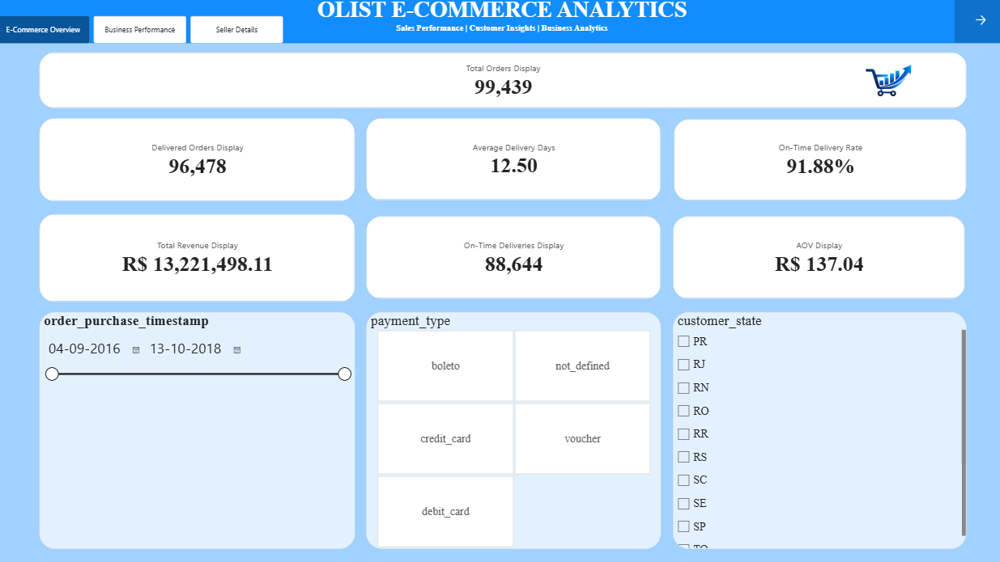
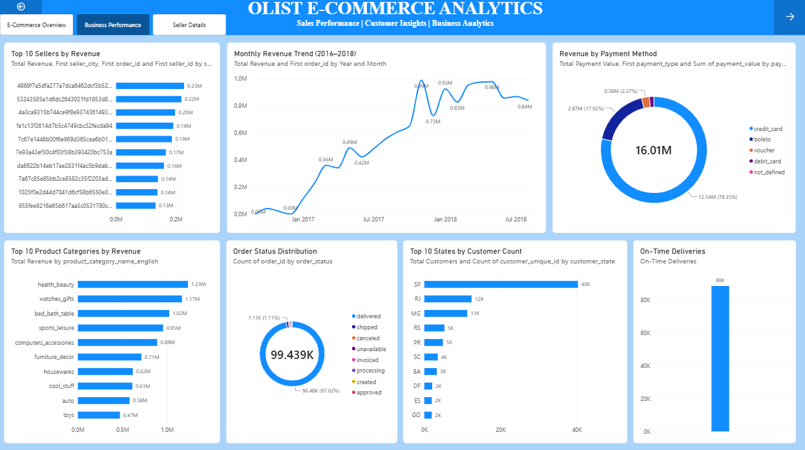
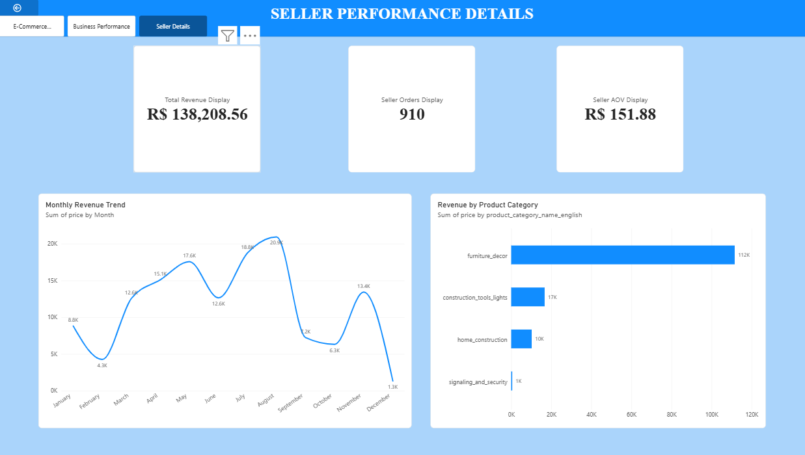

# E-Commerce Sales Data Analytics Project

## Project Overview

This project analyzes Brazilian e-commerce data from the Olist
marketplace to discover business insights and understand sales
performance, customer behavior, product categories, payment
preferences, and seller performance.

The project follows an end-to-end data analytics workflow using
Python, MySQL, and Power BI. It includes data exploration,
cleaning, SQL analysis, data visualization, and an interactive
business intelligence dashboard.

## Tools and Technologies

| Technology | Purpose |
|---|---|
| Python | Data cleaning, analysis and visualization |
| Pandas | Data manipulation and processing |
| NumPy | Numerical operations |    
| Matplotlib | Data visualization |
| Seaborn | Statistical visualization |
| MySQL 8.4 | Database management and SQL analysis |
| Power BI | Interactive dashboard development |
| Visual Studio Code | Code development environment |
| Git & GitHub | Version control and project hosting |


## Project Structure

```text
E-Commerce-Sales-Data-Analytics/
│
├── data/
│   ├── raw/                  # Original datasets (not uploaded)
│   └── processed/            # Cleaned and analyzed datasets
│
├── notebook/                 # Jupyter notebooks
│
├── reports/                  # Analysis charts and visualizations
│
├── sql/
│   └── 01_business_analysis.sql
│
├── 01_dataset_exploration.py
├── 02_data_cleaning.py
├── 03_order_status_analysis.py
├── 04_order_status_visualization.py
├── 05_revenue_analysis.py
├── 06_customer_analysis.py
├── 06_monthly_revenue_visualization.py
├── 07_product_analysis.py
├── 08_payment_analysis.py
├── 09_seller_analysis.py
│
├── E-Commerce Analysis.pbix
├── README.md
└── .gitignore
```


## Project Workflow

1. **Data Exploration:** Examined the dataset using Python.
2. **Data Cleaning:** Cleaned and prepared the data for analysis.
3. **Python Analysis:** Analyzed orders, revenue, customers, products, payments, and sellers.
4. **SQL Analysis:** Used MySQL queries to perform business analysis.
5. **Power BI Dashboard:** Developed interactive dashboards to present business insights.


## Key Business Insights

The analysis of the Olist Brazilian e-commerce dataset revealed the following results:

| Business Metric | Result |
|---|---:|
| Total Orders | 99,441 |
| Delivered Orders | 96,478 |
| Total Product Revenue | R$13,221,498.11 |
| Average Order Value | R$137.04 |
| Average Delivery Time | 12.50 days |
| On-Time Deliveries | 88,644 |
| On-Time Delivery Rate | 91.88% |

### Analysis Areas

- **Sales Analysis:** Examined revenue trends and order performance.
- **Customer Analysis:** Identified customer distribution across states.
- **Product Analysis:** Analyzed top-performing product categories.
- **Payment Analysis:** Studied customer payment preferences.
- **Seller Analysis:** Evaluated seller revenue and performance.
- **Delivery Analysis:** Examined order status and delivery performance.


## Power BI Dashboard

The interactive Power BI dashboard contains three pages:

### 1. E-Commerce Overview


### 2. Business Performance


### 3. Seller Details


## Power BI Dashboard

The Power BI report contains three pages:

1. **E-Commerce Overview:** Key performance indicators and interactive filters.
2. **Business Performance:** Revenue trends, seller performance, payment methods, product categories, and customer states.
3. **Seller Details:** Seller-specific revenue, orders, average order value, and product category analysis using drill-through.

## SQL Analysis

SQL queries are used to analyze:
- Overall sales performance
- Order and delivery status
- Customer distribution
- Product category performance
- Payment methods
- Seller revenue

## Project Objective

The main objective is to demonstrate practical data analytics skills, including data preparation, database querying, business analysis, data visualization, and interactive dashboard development.

## Future Improvements

- Add more advanced business performance metrics.
- Improve predictive sales analysis.
- Explore customer segmentation.
- Develop additional interactive visualizations.

---
**Project:** E-Commerce Sales Data Analytics  
**Tools:** Python | MySQL | Power BI